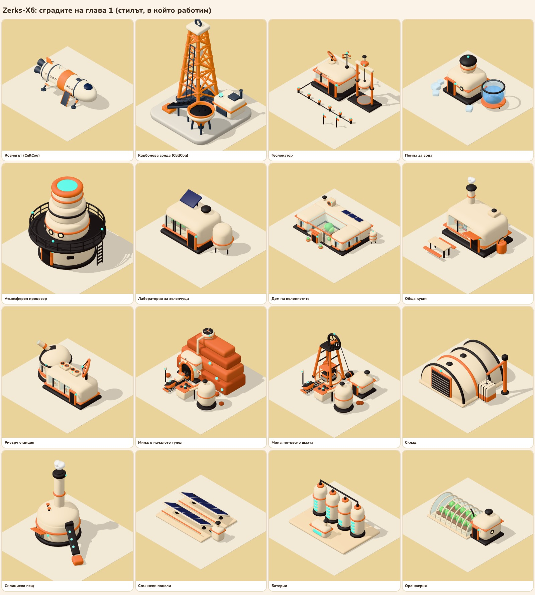

# Сградите на Zerks-X6: стилът, в който работим

**Решено (Жоро, 05.11.2026): всички 3D сгради на играта се правят в този стил.** Тук са моделите, които стоят на картата, правилата на стила и как се правят отново. По-ранните опити (пакетите KayKit, пребоядисани, и кръглите тела в цветовете на Ковчега) отпаднаха и не се ползват.



## Моделите на картата

| Файл | Сграда | Какво се вижда |
| --- | --- | --- |
| `../ark-v1.glb` | Ковчегът | Корабът, с който сме дошли; от CellCog |
| `../carbon-drill-v1.glb` | Карбонова сонда | Кула над отвора; от CellCog |
| `geolocator.glb` | Геолокатор | Сеизмична станция (идея Г5, Жоро, 05.11.2026): малка станция с прозорец, през който се вижда екранът с вълната; до нея тежест между две оранжеви стойки, вдигната с въже от мотора горе, пада върху плоча в земята; редица датчици в земята, вързани с един кабел до станцията, чуват ехото от пластовете; чиния и метеомачта на покрива; знаменца на намерения залеж. На картата заема задната половина на парцела, панелите и батериите са отпред |
| `pump.glb` | Помпа за вода | Помпена къщичка с кладенец на покрива, прозрачен резервоар с вода на крака, тръба с кран, лед |
| `processor.glb` | Атмосферен процесор | Основа с врата, тъмна платформа с парапет и стълба, кула на етажи с ленти и прозорчета, светеща горна част |
| `veglab.glb` | Лаборатория за зеленчуци | Заоблена кутия с прозорец, през който се виждат лехите с растения; слънчев панел и отдушник на покрива, резервоар на крака |
| `home-1.glb`, `home-10.glb`, `home-20.glb` | Дом на колонистите (досега „жилищен купол“) | Кооперация със зимна градина (идея В, Жоро, 06.11.2026), по нивата на дома. Ниво 1: блок с две стаи и стъклено антре. Ниво 10: две крила напред, а дворът между тях е покрит със стъкло: градина с дърво и пейки, общата стая. Ниво 20: втори етаж на трите крила и градинки под стъкло на покрива. Всяка стая е за двама, двете легла се виждат през прозореца; шлюз на входа, резервоар за вода, уред за въздуха и слънчеви плочки на покрива. Старият купол е в `ideas/dome-old.glb` |
| `kitchen.glb` | Обща кухня | Заоблена кутия с голям прозорец: през стъклото се виждат масата, столът и печката; комин с пара, сенник над вратата, варел, маса с пейки отпред |
| `research-1.glb`, `research-10.glb` | Рисърч станция | Обсерватория и компютри (идея Б, Жоро, 06.11.2026). Кула с купол: процепът е отворен и телескопът гледа навън. До нея стая с компютри: през прозореца се виждат шкафовете със светлинки и пулт с два екрана и стол. На покрива чиния към Ковчега и орбитата и охладител с два вентилатора, защото компютрите се топлят. `research-1` е до ниво 10 на Ковчега; `research-10` е след подобрението там: стаята е по-дълга, с втори пулт и шкафове (вторият слот), а в кулата е кабинетът на учения с бюро, екран и рафт с проби. Старата станция е в `ideas/research-old.glb` |
| `mine-portal.glb` | Мина, в началото | Тунел в стената на каньона: локомотивче изкарва пълна количка от тунела; релсите водят до бункера, където количката изсипва рудата; лента до силоза; вентилатор на скалата вкарва въздух в тунела по тръба |
| `mine.glb` | Мина, по-късно | Шахта: кабината изкарва количката под кулата с колелото; релсите водят до бункера, където количката изсипва рудата; лента до силоза; въжето минава през колелото до лебедката. Кога мината става шахта, ще решим; предложение: ниво 10 на мината |
| `warehouse.glb` | Склад | Хангар с ребра, затворен отпред и отзад: на предната стена ролетна врата в оранжева рамка; гъбовидни отдушници между ребрата; кран, който държи контейнер на въже за халка на капака |
| `furnace.glb` | Силициева пещ | Барабан с купол, прозорец към огъня под сенник, висок комин с лента и светлини, лента с кварц и бункер |
| `solar.glb` | Слънчеви панели | Два реда панели в кремави рамки на стойки, инвертор със светлини и отдушник, кабел |
| `batteries.glb` | Батерии | Четири изправени клетки с ленти за заряда, общ кабел, контролна кутия |
| `greenhouse.glb` | Оранжерия | Стъклена арка с ребра, затворена със стъкло и в двата края, вътре лехи с растения; сервизен модул с врата, прозорче и отдушник |

Всички са в `mockup/map.html#kk20` (и `#kk50`, `#kk85`, `#kk20-night`); кадрите са в `mockup/screens` (`buildings-kk`, `map-kk-*`, `mine-kk`, `mine-portal-kk`).

## Идеите за геолокатора

**Геолокаторът** (05.11.2026): първият `geolocator.glb` (кръгла станция с екран, купол и въртяща се ръка със скенер) беше твърде гол; той е запазен в `ideas/geolocator-old.glb`. Направени бяха седем идеи в `ideas/`, сравнени на `ideas/geolocator-ideas.jpg` (Г1–Г3) и `ideas/geolocator-ideas-2.jpg` (Г4–Г7). **Жоро избра Г5, сеизмичната станция**: тя вече е `geolocator.glb` и се прави от `src/build.py` (`b_geolocator`). Останалите идеи се пазят за справка.

| Файл | Идея |
| --- | --- |
| `ideas/geolocator-1.glb` | Радарна станция в контейнер: въртяща се чиния, бюро с екран и картата зад прозореца, метеорологична мачта, слънчев панел, знаменца на залежа |
| `ideas/geolocator-2.glb` | Скенер: триножна сонда в земята със светещи кръгове, кабина със стъклен купол и светещ глобус на планетата с точките на залежите, проби от скалата (препоръката на Claude) |
| `ideas/geolocator-3.glb` | Пост в контейнер: малка обсерватория с телескоп, антена, голям циферблат за въздуха (7%), ветрогонка, сонда в земята |

Скриптът е `src/geolocator_ideas.py`.

Още четири идеи (05.11.2026, Жоро поиска още вариации), сравнени на `ideas/geolocator-ideas-2.jpg`; проверени отгоре и от четирите страни:

| Файл | Идея |
| --- | --- |
| `ideas/geolocator-4.glb` | Сондажна кула: контейнер, а зад него кула с макара; лебедката спуска сонда по въже в сондажа. На екрана в контейнера са пластовете, до кулата са извадените ядки, на покрива е метеомачта |
| `ideas/geolocator-5.glb` | **Избрана.** Сеизмична станция: тежест между две стойки пада върху плоча, редица датчици в земята, свързани с един кабел, чуват ехото от пластовете. На екрана е вълната, на покрива чиния и метеомачта |
| `ideas/geolocator-6.glb` | Станция с дрон: дрон с големи перки (въздухът е рядък) и слънчев панел каца на площадката на покрива и се зарежда; ветрогонка, стълба, панел отстрани. На екрана е картата с намерените места |
| `ideas/geolocator-7.glb` | Сегашният геолокатор, допълнен: прозорец към пулта, сонда в земята с кабел, сандък със запаси от контейнерите с панел, метеомачта, кръгли прозорчета отзад |

Скриптът е `src/geolocator_ideas2.py`.

## Идеите за дома на колонистите

**Домът** (06.11.2026): Жоро иска жилищният купол да прилича повече на къща или кооперация, но пак технологичен и в стила на другите. Три идеи, всяка на ниво 1, 10 и 20 на дома (по docs/levels.md: 4 места до ниво 4, после по едно на ниво; втори етаж на ниво 11; 20 места на ниво 20). Всяка стая е за двама и има един прозорец с двете легла зад стъклото, така че прозорците броят местата. Всеки дом има шлюз на входа, резервоар за вода и уред за въздуха. Сравнени са на `ideas/home-ideas.jpg`; скриптът е `src/home_ideas.py`. **Жоро избра В** (06.11.2026): тя вече е `home-1.glb`, `home-10.glb` и `home-20.glb` и се прави от `src/build.py` (`b_home`).

| Файл | Идея |
| --- | --- |
| `ideas/home-a-1.glb`, `-10`, `-20` | А, капсулна кооперация: кръгло ядро с шлюза и стълбите, спалните са капсули, закачени за ядрото; от ниво 11 втори ред капсули, на 20 стъклена градина на покрива |
| `ideas/home-b-1.glb`, `-10`, `-20` | Б, редова къща: дълга къща с мек двускатен покрив, слънчеви плочки, шлюз-веранда; расте стая по стая, от ниво 11 етаж с балкони, на 20 зимна градина в края |
| `ideas/home-c-1.glb`, `-10`, `-20` | В, кооперация със зимна градина: първо блок със стъклено антре, после две крила и стъклен двор с дърво и пейки (общата стая); от ниво 11 етаж, на 20 градинки на покрива |

Идеите на ниво 20 са около 380 KB; избраният дом е облекчен (по-малко сегменти на леглата и сливане на частите с еднакъв материал) и е 59, 108 и 148 KB.

## Идеите за рисърч станцията

**Рисърч станцията** (06.11.2026): Жоро поиска 2–3 варианта как да изглежда. Три идеи, всяка на ниво 1 и на ниво 10. По docs/levels.md на ниво 1 върви едно проучване, а на ниво 10 станцията получава втори слот и място за учен. Затова всеки слот е място, което се вижда през стъклото, а ученият има кабинет с бюро, екран и стол. Сравнени са на `ideas/research-ideas.jpg` (двете нива в един мащаб) и `ideas/research-ideas-close.jpg` (ниво 10 отблизо отпред). Проверени са отгоре и от четирите страни. Скриптът е `src/research_ideas.py`, а листът се прави от `mockup/catalog.html#set=research` (`node shot-catalog.js research`). **Жоро избра Б** (06.11.2026): тя вече е `research-1.glb` и `research-10.glb` и се прави от `src/build.py` (`b_research`); старата станция е запазена в `ideas/research-old.glb`.

| Файл | Идея |
| --- | --- |
| `ideas/research-a-1.glb`, `-10` | А, лаборатория с проби: ядките от геолокатора и скалата от мината идват в сандък, кратка лента ги носи до люк в дясната стена, гледат се на пейката с микроскопа зад големия прозорец; над пейката на покрива е отдушникът. На ниво 10 отляво се долепя втора лаборатория с анализатор и центрофуга (слот 2), а на покрива е стъкленият кабинет на учения |
| `ideas/research-b-1.glb`, `-10` | Б, обсерватория и компютри: кула с купол, отворен процеп и телескоп; до нея стая с шкафове с компютри и пулт с два екрана, на покрива чиния към Ковчега и орбитата и охладител с два вентилатора за компютрите. На ниво 10 стаята е по-дълга, с втори пулт и шкафове (слот 2), а кабинетът на учения гледа през прозорец в кулата |
| `ideas/research-c-1.glb`, `-10` | В, работилница за прототипи: новият чертеж се вижда като холограма над кръгла маса, робот ръка сглобява частта, а готовото излиза през ролетната врата в дясната стена на площадката за проби с новия дрон и стълбче за зареждане. На тавана има прозорец над залата. На ниво 10 залата е по-широка, с втора холомаса (слот 2), а кабинетът на учения е малък горен етаж с прозорец |

## Правилата на стила

Стилът идва от първия вариант на CellCog, който Жоро избра. Всяка нова сграда се прави по тези правила.

1. **Форми.** Меки и заоблени, по детски и приятни за окото. Няма остри ръбове: всеки ъгъл е закръглен.
2. **Тяло.** Топло кремаво. Отдолу има тъмна основа (цокъл), а около тялото тънка оранжева лента.
3. **Детайли, по които личи за какво е сградата.** Гъбовидни отдушници на покрива, малки тюркоазени светлинки, кръгли прозорчета с тъмна рамка и тъмни врати в оранжева рамка. Където трябва, има сенници, комини с пара, антени, резервоари и тръби.
4. **Прозорците** светят топло. **Стъклото** е прозрачно и зад него се вижда осветена стая с мебели, растения или машини.
5. **Логика.** Всичко в сградата работи заедно и пътят на материала се вижда: откъде идва, къде отива и къде се трупа. Нищо не се пресича: тръби, релси, ленти и въжета минават свободно. Всяка сграда се проверява отгоре и от три страни.
6. **Посока.** Вратата гледа напред (−y в Blender, +z в играта). На картата сградите стоят подравнени с улиците и парцелите, а камерата ги вижда откъм ъгъла, с вратата на лявата стена.
7. **Размер и тежест.** Една сграда е около 2–2,5 единици широка. Файлът е компресиран с Draco и е под около 250 KB.

| Цвят | Код | За какво |
| --- | --- | --- |
| Крем | `#f6e4c6` | Телата на сградите |
| Тъмен крем | `#efd6b0` | Площадки, рамки, втори план |
| Оранжево | `#ef7433` | Лентите, рамките на вратите, сенниците, кулите |
| Въглен | `#2e2a2a` | Основите, вратите, отдушниците, релсите |
| Тюркоаз (свети) | `#3fe0d0` | Малките светлинки, лентите за заряд, екраните |
| Топъл прозорец (свети) | `#fff2c2` | Прозорците и прозорчетата |
| Зелен прозорец (свети) | `#c6f58a` | Лабораториите с растения |
| Стъкло | `#d8f6f2`, прозрачност около 26% | Куполи, витрини, резервоари |
| Скала | `#d4693b`, `#b8532d` | Скалите и хълмовете |
| Слънчев панел | `#262b55` | Панелите |

## Откъде са частите

Всичко е направено в кода (`src/build.py`, `src/kb.py`). Само масата, столът и печката в кухнята са от [KayKit Restaurant Bits](https://github.com/KayKit-Game-Assets/KayKit-Restaurant-Bits-1.0), безплатен пакет с лиценз CC0 (свободен и за търговска игра, без посочване на автора).

## Как се правят отново

Трябва Blender като модул на Python (`pip install bpy`, 5.x) и KayKit Restaurant Bits в `src/assets/` (или пътят в `ZERKS_ASSETS`):

```bash
git clone --depth 1 https://github.com/KayKit-Game-Assets/KayKit-Restaurant-Bits-1.0 src/assets/KayKit-Restaurant-Bits-1.0
```

```bash
python src/build.py -- out
```

Само една сграда (името е ключът в `BUILD` в края на `src/build.py`, например `mine-portal`):

```bash
python src/build.py -- out kitchen,mine
```

После всеки файл се компресира с Draco (макетът го чете с `DRACOLoader`):

```bash
npx @gltf-transform/cli optimize out/kitchen.glb kitchen.glb --compress draco --texture-compress false --simplify false --flatten false --join false --instance false --palette false
```

Домът се слива по материали, за да е лек (`home-1`, `home-10`, `home-20`):

```bash
npx @gltf-transform/cli optimize out/home-20.glb home-20.glb --compress draco --texture-compress false --simplify false --flatten true --join true --instance false --palette false
```

Тяло, което лежи на земята като половин цилиндър (хангарът, стъклената арка), се реже с `cut_below`, не с `cut_half`. `cut_half` трие всяка стена, която има точка под линията, а капакът на цилиндъра е една стена, затова изчезваше цял. Така складът и оранжерията бяха отворени в краищата, докато Жоро не го забеляза на 06.11.2026. Освен това `cyl` вдига центъра с половин дебелина нагоре, както трябва за изправен цилиндър; за легнал цилиндър височината се намалява с толкова.

Каталогът (`catalog.jpg`) и телефонният му вариант (`mockup/screens/buildings-kk.jpg`) се правят от `mockup/catalog.html` със светлината и камерата на картата. В `mockup`, при пуснат `npm run serve`:

```bash
node shot-catalog.js
```

Излизат `out/catalog.jpg` и `out/buildings-kk.jpg`; копират се на местата си.
