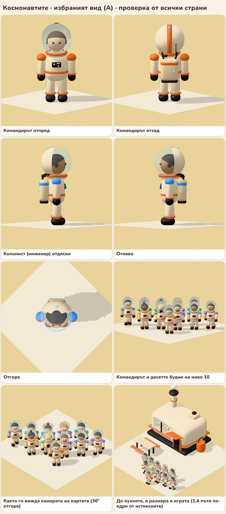
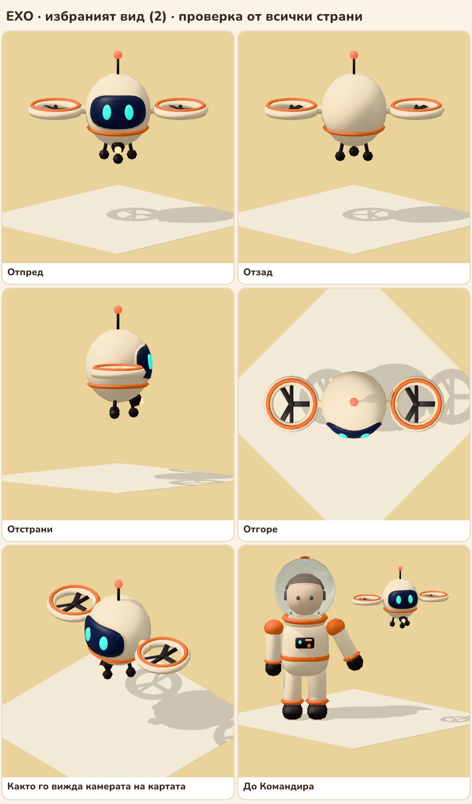

# Хората и ЕХО: 3D моделите

**Решено (Жоро, 14.11.2026: „А и ЕХО 2“).** Хората са в скафандър със стъклен шлем, зад който се вижда лицето. ЕХО е малко тяло между две перки в пръстени. И двете са в стила на сградите (`../buildings/README.md`): кремави заоблени тела, оранжева лента, тъмна основа, тюркоазени светлинки, стъкло, зад което се вижда нещо.

На 14.11.2026 Жоро поиска да оправим вида на играта едно по едно: космонавтите и ЕХО, менютата, картата и средата, материалите. Това е първото.



## Моделите за играта

| Файл | Какво е |
| --- | --- |
| `colonist.glb` | Един модел за Командира и всички колонисти (42 KB; един човек е около 4 900 триъгълника, а с всички части по избор моделът е 5 600) |
| `echo.glb` | ЕХО (23 KB, около 3 900 триъгълника) |
| `looks.json` | Цветът на всяка професия и видът на Командира и на 15-те назовани колонисти (предложение) |
| `people.jpg`, `echo-views.jpg` | Проверката от всички страни: отпред, отзад, отстрани, отгоре, от камерата на картата и до кухнята |

На картата на ниво 10 са в макета (`mockup/map.html#lvl10`); кадрите са `mockup/screens/map-lvl10-commander.jpg`, `-commander-night.jpg` и `-colonist.jpg`.

### Човекът

Нисък и мек, около 1,7 м. Отдолу нагоре: тъмни обувки с оранжев пръстен на глезена, кремави крака, кремаво тяло с оранжев колан, панел на гърдите със светлинка и копче, раница с животоподдържането (отдушник, светлинка, два маркуча до яката), оранжева яка и прозрачен шлем. Задната половина на шлема е кремава черупка с лампа отгоре. Зад стъклото се вижда лицето: кожа, коса, очи и слушалките на радиото.

Професията личи по цвета на раменете, лентата на раницата и копчето на гърдите. Командирът има и оранжева лента през шлема и антена на раницата.

Как играта прави различни хора от един модел:
- материалите `accent`, `skin` и `hair` се оцветяват за всеки човек;
- под `body` стоят частите по избор: `hair_short`, `hair_bun`, `hair_full` (показва се една), `beard`, и само за Командира `stripe` и `aerial`;
- `looks.json` казва за всяко име кое да се покаже. Имената са тези от играта в Unity (`unity/Zerk-X6/Assets/Zerks/Sim/Texts.cs`), които също са предложение.

Цветовете на професиите (предложение): Командир оранжево `#ef7433`, готвач жълто `#ffc65c`, агроном зелено `#4fc06a`, геолог лилаво `#9a7cff`, инженер синьо `#5aa9ff`, учен тюркоаз `#33c5a2`.

Движението: `body`, `arm_l`, `arm_r`, `leg_l`, `leg_r` са отделни части и началото на всяка ръка и крак е в ставата. Играта ги люлее с едно завъртане, както сега прави с простите фигури. Лакти и колене няма.

### ЕХО



ЕХО е бордовият изкуствен интелект на Ковчега в малко летящо тяло (`docs/concept.md`). Въздухът е рядък, затова лети като строителния дрон: с перки в пръстени, широки за размера му. Тяло като яйце с тъмна основа и оранжева лента, две перки на къси рамене, тъмен визьор с две овални тюркоазени очи, оранжева светлинка на антената, лампа под брадичката, с която сочи къде да натиснеш, и три крачета за кацане.

Частите: `body`, `rotor_l`, `rotor_r` (въртят се), а под `body` са `eye_l` и `eye_r`, за да мига.

### Размерът в играта (предложение)

Моделите са в истински мерки: човек 1,7 м, ЕХО около 1 м с перките. В макета хората са 1,4 пъти по-едри (2,4 м, колкото сегашните прости фигури в Unity), а ЕХО 2,4 пъти, за да се натиска. На цялата карта хората пак са дребни; дали да са по-едри, се решава, когато се видят в играта.

## Отхвърлените идеи

Листовете за сравнение са в `ideas/` (`astro-a.jpg`, `astro-b.jpg`, `astro-c.jpg`, `echo.jpg`, `echo-back.jpg`), с моделите до тях.

| Идея | Какво беше | Защо не |
| --- | --- | --- |
| **А · Стъкленият шлем** | Избраната | |
| Б · Класическият скафандър | Истински пропорции, бял шлем със златен визьор, цветни ленти по ръцете, краката и шлема | На картата фигурите са тънки и лентите едва личат |
| В · Работният костюм | Твърда черупка като сградите, тъмен визьор с тюркоазена линия, цветна каска, две бутилки с въздух | Без лице прилича на робот и се бърка с ЕХО |
| ЕХО 1 · Топчето | Кръгла глава над една широка перка в пръстен, едно око като черта | |
| **ЕХО 2 · Двете перки** | Избраната | |
| ЕХО 3 · Малкият дрон | Плоско тяло с четири перки и екран с очи | Бърка се със строителния дрон |

Причините в третата колона са оценката на Claude; Жоро каза само кои избира.

## Как се правят отново

Трябва Blender като модул на Python (`pip install bpy`, 5.x). Помощните функции идват от `../buildings/src`. Мерките са в метри, а фигурите гледат по −y в Blender, както вратите на сградите (+z в играта).

Всичко в една папка (моделите за играта, тези за листовете и `looks.json`):

```bash
python art/3d/characters/src/characters.py -- out
```

Само някои (имената са ключовете в `JOBS` в края на скрипта):

```bash
python art/3d/characters/src/characters.py -- out colonist,echo,looks
```

Компресията с Draco е с инструментите, които проектът в `game/` вече има (модулът `bpy` тук не я прави сам):

```bash
cd game && npm ci && node ../art/3d/characters/src/draco.mjs ../out ../art/3d/characters
```

Листовете са от `mockup/catalog.html` (`#set=people`, `echofinal`; идеите: `astroa`, `astrob`, `astroc`, `echo`, `echoback`), при пуснат сървър на порт 8777. Моделите за листовете (`final-*.glb`) не са в репото: правят се от скрипта направо в `mockup/models/ch/`.

```bash
python art/3d/characters/src/characters.py -- mockup/models/ch
```

```bash
cd mockup && node shot-catalog.js people
```

Кадрите на картата: `cd mockup && node shot-map.js`.

## Какво не е проверено

- **Unity.** Моделите са гледани само в three.js (макета). Какво да се смени там е в `docs/unity-plan.md`, „Хората и ЕХО“. Прозрачният шлем и светещите материали може да искат настройка.
- **Ходенето.** Позите на листовете са статични завъртания в ставите; движение в игра още никой не е гледал.
- **Тежестта с много хора.** 4 900 триъгълника на човек е сметнато за десетина души на екрана; за 100 колонисти ще трябва по-лек вариант за далечните.
