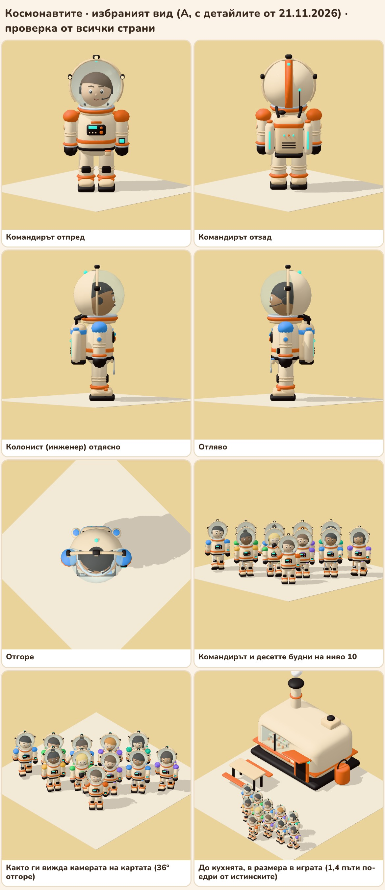
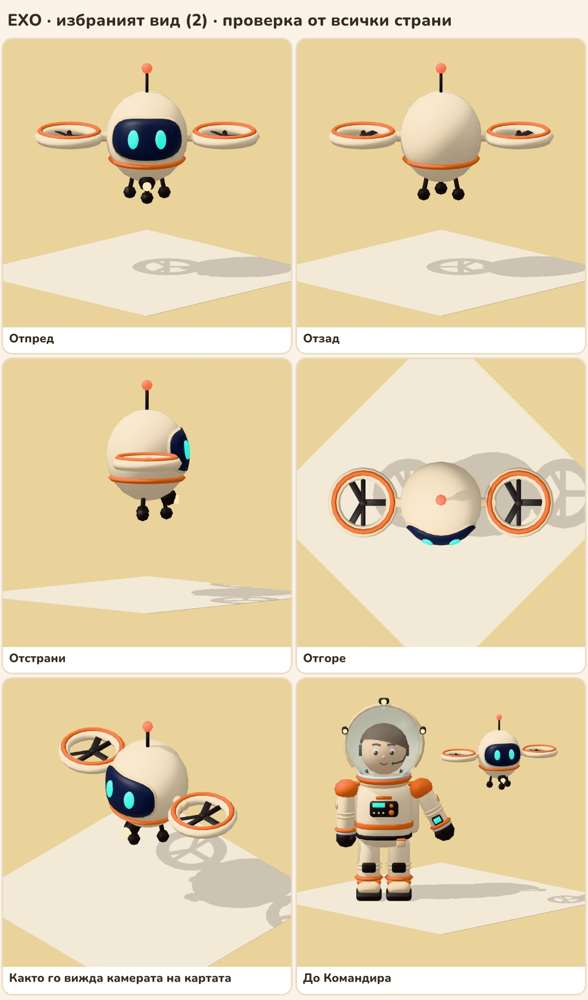
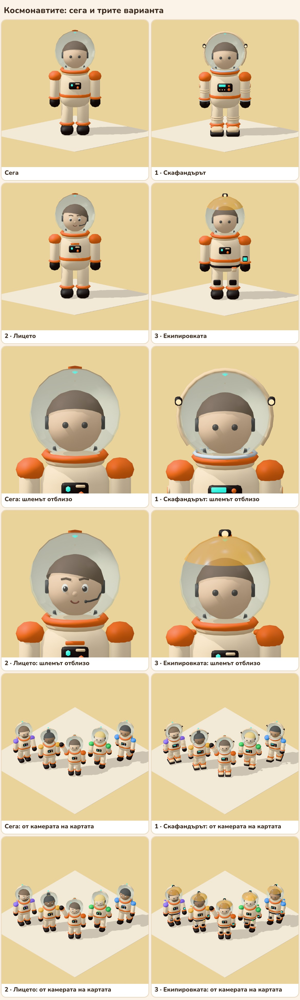
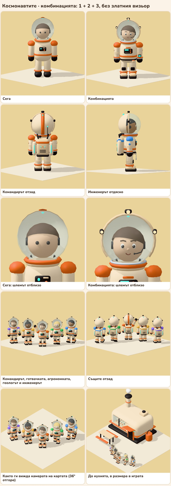

# Хората и ЕХО: 3D моделите

**Решено (Жоро, 14.11.2026: „А и ЕХО 2“).** Хората са в скафандър със стъклен шлем, зад който се вижда лицето. ЕХО е малко тяло между две перки в пръстени. И двете са в стила на сградите (`../buildings/README.md`): кремави заоблени тела, оранжева лента, тъмна основа, тюркоазени светлинки, стъкло, зад което се вижда нещо.

На 14.11.2026 Жоро поиска да оправим вида на играта едно по едно: космонавтите и ЕХО, менютата, картата и средата, материалите. Това е първото.

**От 21.11.2026 хората са по-детайлни (Жоро: „Комбинация от всичко без ето това оранжевото над главите им“, после „Да, направи я новия модел“).** Същият вид, с детайлите на трите варианта от 21.11.2026 заедно, без вдигнатия златен визьор (виж „Три варианта за повече детайли“ по-долу).



## Моделите за играта

| Файл | Какво е |
| --- | --- |
| `colonist.glb` | Един модел за Командира и всички колонисти (83 KB; от 21.11.2026 един човек е около 10 300 триъгълника, а с всички части по избор моделът е 12 500; преди беше 4 900 и 5 600) |
| `echo.glb` | ЕХО (23 KB, около 3 900 триъгълника) |
| `looks.json` | Цветът на всяка професия, инструментът ѝ и видът на Командира и на 15-те назовани колонисти (предложение) |
| `people.jpg`, `echo-views.jpg` | Проверката от всички страни: отпред, отзад, отстрани, отгоре, от камерата на картата и до кухнята |

На картата на ниво 10 са в макета (`mockup/map.html#lvl10`); кадрите са `mockup/screens/map-lvl10-commander.jpg`, `-commander-night.jpg` и `-colonist.jpg` (преснимани с новия модел на 21.11.2026, заедно с останалите кадри на картата, портретите в `mockup/ui/thumbs` и менютата).

### Човекът

Нисък и мек, около 1,7 м. Отдолу нагоре: кремави ботуши на дебела тъмна подметка с оранжева каишка, оранжев пръстен на глезена, кремави крака с по две гънки на коленете и тъмни наколенки, кремаво тяло с оранжев колан и тъмен колан с джоб под него, модулът на гърдите (екран, три копчета, две ръчки) и над него лента в цвета на професията, ръце с по две гънки на лактите, кръгла нашивка на рамото, стоманен пръстен на китката и ръкавица с палец, компютър на лявата ръка, раница с животоподдържането (решетка, три светлинки, отдушник, два маркуча до яката) и две бутилки с въздух отстрани с ленти за заряда, оранжева яка, стоманен пръстен, на който се заключва шлемът, и прозрачен шлем в кремава рамка с лампа от всяка страна и една отгоре. Задната половина на шлема е кремава черупка. Зад стъклото се вижда лицето: кожа, очи с бяло и отблясък, вежди, нос, усмивка, коса с път отстрани, слушалките на радиото и микрофонът.

Професията личи по цвета на раменете, нашивката, лентата на гърдите и на раницата, ръчката на модула, капачките на бутилките и по инструмента на десния хълбок: черпак за готвача, лопатка за агронома, чук за геолога, ключ за инженера, таблет за учения (предложение; Командирът и строителят нямат). Командирът има и оранжева лента през шлема и антена на раницата.

Как играта прави различни хора от един модел:
- материалите `accent`, `skin` и `hair` се оцветяват за всеки човек;
- под `body` стоят частите по избор: `hair_short`, `hair_bun`, `hair_full` (показва се една), `beard`, само за Командира `stripe` и `aerial`, и от 21.11.2026 инструментите `tool_hammer`, `tool_wrench`, `tool_trowel`, `tool_ladle`, `tool_tablet` (показва се само този от `tool` в `looks.json` за професията, иначе нито един);
- `looks.json` казва за всяко име кое да се покаже. Имената са тези от играта в Unity (`unity/Zerk-X6/Assets/Zerks/Sim/Texts.cs`), които също са предложение.

Цветовете на професиите (предложение): Командир оранжево `#ef7433`, готвач жълто `#ffc65c`, агроном зелено `#4fc06a`, геолог лилаво `#9a7cff`, инженер синьо `#5aa9ff`, учен тюркоаз `#33c5a2`, строител червено `#e0574f` (20.11.2026).

Движението: `body`, `arm_l`, `arm_r`, `leg_l`, `leg_r` са отделни части и началото на всяка ръка и крак е в ставата. Играта ги люлее с едно завъртане (в Unity: `Figure` в `Game/Movers.cs`). Лакти и колене няма.

### ЕХО



ЕХО е бордовият изкуствен интелект на Ковчега в малко летящо тяло (`docs/concept.md`). Въздухът е рядък, затова лети като строителния дрон: с перки в пръстени, широки за размера му. Тяло като яйце с тъмна основа и оранжева лента, две перки на къси рамене, тъмен визьор с две овални тюркоазени очи, оранжева светлинка на антената, лампа под брадичката, с която сочи къде да натиснеш, и три крачета за кацане.

Частите: `body`, `rotor_l`, `rotor_r` (въртят се), а под `body` са `eye_l` и `eye_r`, за да мига.

### Размерът в играта (предложение)

Моделите са в истински мерки: човек 1,7 м, ЕХО около 1 м с перките. В макета хората са 1,4 пъти по-едри (2,4 м, колкото бяха простите фигури в Unity), а ЕХО 2,4 пъти, за да се натиска. На цялата карта хората пак са дребни; дали да са по-едри, се решава, когато се видят в играта.

## Три варианта за повече детайли (предложение, 21.11.2026)

Жоро (21.11.2026): „Искам да елевейтнем малко визията на самите астронавти, да изглеждат една идея по-добре, малко по-детайлни… Искам да ми изпратиш 3 варианта“. И трите са върху избрания вид А: същите пропорции, стъкленият шлем с лицето, цветовете на стила, същите части, стави и материали (`accent`, `skin`, `hair`), така че всеки влиза в Unity на мястото на `colonist.glb`. Още нищо не е избрано.



| Вариант | Какво добавя | Триъгълници на човек (сега 4 900) |
| --- | --- | --- |
| 1 · Скафандърът | Детайлите на истински скафандър: кремави ботуши с дебела тъмна подметка и оранжева каишка, по две гънки на коленете и лактите, стоманени заключващи пръстени на китките и на врата, палци на ръкавиците, кръгла нашивка на рамото в цвета на професията, модулът на гърдите с екран, копчета и две ръчки, рамка около шлема с лампа от всяка страна, решетка и три светлинки на раницата (`ideas/elevate-1.jpg`) | около 8 000 |
| 2 · Лицето | По-живо лице: очи с бяло, тъмен ирис и отблясък, вежди в цвета на косата, нос, усмивка, микрофонът на радиото; косата с път отстрани, кичури при дългата, ластик на кока, мустак при брадата; лента с цвета на професията на гърдите (`ideas/elevate-2.jpg`) | около 5 500 |
| 3 · Екипировката | Работният екип: компютър на лявата ръка, наколенки, колан с инструменти и джоб, инструментът на професията на десния хълбок (чук за геолога, ключ за инженера, лопатка за агронома, черпак за готвача, таблет за учения), две бутилки с въздух на раницата с ленти за заряда като батериите, вдигнат златен визьор и лампа на шлема (`ideas/elevate-3.jpg`) | около 7 000 |

**Изборът: комбинацията (Жоро, 21.11.2026: „Комбинация от всичко без ето това оранжевото над главите им“).** Вариантите 1, 2 и 3 заедно, без вдигнатия златен визьор. Където се засичат: компютърът на ръката е по-нисък, под гънките на лакътя; лампата отгоре стои на рамката на шлема; наколенките са върху гънките на коленете. Един човек е около 10 300 триъгълника (сега 4 900), моделът за играта с всички части по избор е 12 500 (`ideas/elevate-4.glb`). Листът е `ideas/elevate-4.jpg` (`catalog.html#set=elevate4`), сега и комбинацията един до друг. От 21.11.2026 това е `colonist.glb` (Жоро: „Да, направи я новия модел“).



Моделите за играта (с всички части по избор) са `ideas/elevate-1.glb`, `-2.glb`, `-3.glb`, `-4.glb`, без компресия с Draco. Третият и комбинацията имат и частите по избор `tool_hammer`, `tool_wrench`, `tool_trowel`, `tool_ladle`, `tool_tablet` под `body`. Правят се с `python art/3d/characters/src/elevate.py -- mockup/models/ch`, а листовете са `catalog.html#set=elevate`, `elevate1` … `elevate3` и `elevate4` (`node shot-catalog.js elevate`).

Какво се вижда къде: от камерата на картата (36° отгоре) личат най-много цветът на ботушите и гънките (1), лицето с очите (2) и тъмният колан, наколенките и златният визьор (3); инструментите на хълбока се виждат чак отблизо, в менютата и в досието. Вариантите могат и да се смесват: например лицето от 2 с ботушите и рамката на шлема от 1.

## Отхвърлените идеи

Листовете за сравнение са в `ideas/` (`astro-a.jpg`, `astro-b.jpg`, `astro-c.jpg`, `echo.jpg`, `echo-back.jpg`), с моделите до тях.

| Идея | Какво беше | Защо не |
| --- | --- | --- |
| **А · Стъкленият шлем** | Избраната | |
| Б · Класическият скафандър | Истински пропорции, бял шлем със златен визьор, цветни ленти по ръцете, краката и шлема | На картата фигурите са тънки и лентите едва личат |
| В · Работният костюм | Твърда черупка като сградите, тъмен визьор с тюркоазена линия, цветна каска, две бутилки с въздух | Без лице прилича на робот и се бърка с ЕХО |
| ЕХО 1 · Топчето | Кръгла глава над една широка перка в пръстен, едно око като черта | |
| **ЕХО 2 · Двете перки** | Избраната | |
| ЕХО 3 · Малкият дрон | Плоско тяло с четири перки и екран с очи | Бърка се със строителния дрон |

Причините в третата колона са оценката на Claude; Жоро каза само кои избира.

## Как се правят отново

Трябва Blender като модул на Python (`pip install bpy`, 5.x). Помощните функции идват от `../buildings/src`. Мерките са в метри, а фигурите гледат по −y в Blender, както вратите на сградите (+z в играта).

От 21.11.2026 хората (`colonist.glb` и `final-*` за листовете) се правят от `elevate.py`, а ЕХО, `looks.json` и старите идеи от `characters.py` (`person()` там е видът от 14.11.2026, на който стъпва `elevate.py`). Имената са ключовете в `VJOBS` и `JOBS` в края на скриптовете:

```bash
python art/3d/characters/src/elevate.py -- out colonist
python art/3d/characters/src/characters.py -- out echo,looks
```

Компресията с Draco е с инструментите, които проектът в `game/` вече има (модулът `bpy` тук не я прави сам):

```bash
cd game && npm ci && node ../art/3d/characters/src/draco.mjs ../out ../art/3d/characters
```

Листовете са от `mockup/catalog.html` (`#set=people`, `echofinal`; идеите: `astroa`, `astrob`, `astroc`, `echo`, `echoback`, `elevate` … `elevate4`), при пуснат сървър на порт 8777. Моделите за листовете (`final-*.glb`) не са в репото: правят се от скриптовете направо в `mockup/models/ch/`.

```bash
python art/3d/characters/src/elevate.py -- mockup/models/ch final-commander,final-colonist,final-crew,final-echo-size
python art/3d/characters/src/characters.py -- mockup/models/ch echo
```

```bash
cd mockup && node shot-catalog.js people
```

Кадрите на картата: `cd mockup && node shot-map.js`; портретите за менютата: `node shot-thumbs.js`; фоновете на менютата: `node shot-bg.js`; менютата: `node shot.js 3 main,build,… menus.html` (`mockup/README.md`).

## Какво не е проверено

- **Unity.** От 16.11.2026 моделите са в играта в Unity (`docs/unity-plan.md`, „Новият вид в Unity“): гледани в Editor-а в размер на iPhone, денем и нощем, отблизо; шлемът е прозрачен и не хвърля сянка. На телефон не са гледани. Новият модел от 21.11.2026 още не е в Unity: `People.cs` там крие само старите части по избор, затова без промяна в кода всеки човек ще носи и петте инструмента (`docs/unity-plan.md`, „По-детайлните хора“).
- **Ходенето.** Позите на листовете са статични завъртания в ставите; движение в игра още никой не е гледал.
- **Тежестта с много хора.** От 21.11.2026 човек е около 10 300 триъгълника (преди 4 900): за десетина души отблизо е добре, но при 30 и повече на картата ще трябва по-лек модел за далечните (например видът от 14.11.2026, `person()` в `characters.py`).
